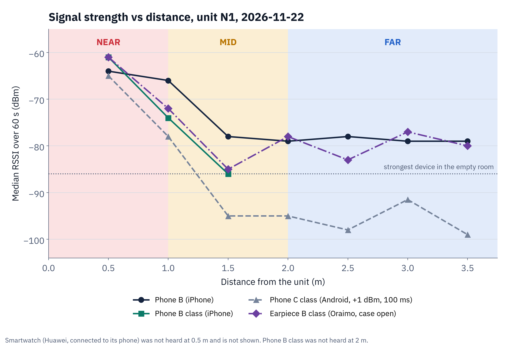

# Calibration: RSSI vs distance, four devices

Date: 2026-11-22. Unit N1 at the edge of the fab lab bench. One 60 s session per device per distance, device on the desk, screen on (phones) or case open (earpiece). Bands as in `docs/data-protocol.md`: near under 1 m, mid 1 to 2 m, far 2 to 3.5 m. Times are local (UTC+2).

Files in this folder:

- `summary.csv`: one row per device and distance (readings, median, quartiles, max, manufacturer). No addresses.
- `baseline.txt`: the empty-room baseline, 11:45 to 11:48.
- `rssi_vs_distance.png`: the poster graph.
- `make_summary.py`: makes all three from `data/raw/` (run from the repo root).

## Devices

| Device | What it is | Manufacturer ID | Heard to |
| --- | --- | --- | --- |
| Phone B | Fab lab iPhone | `0x004C` (Apple) | 3.5 m |
| Phone B class | A classmate's iPhone | `0x004C` (Apple) | 1.5 m |
| Phone C class | Android phone advertising from nRF Connect at +1 dBm, 100 ms interval, no manufacturer data | none | 3.5 m (weak) |
| Earpiece B class | Oraimo buds, case open | `0x0942` (Oraimo) | 3.5 m |
| Watch A class | Huawei smartwatch, connected to its phone | none seen | not heard |

## Median RSSI (dBm)

| Distance | Band | Phone B | Phone B class | Phone C class | Earpiece B class |
| --- | --- | --- | --- | --- | --- |
| 0.5 m | near | -64 | -61 | -65 | -61 |
| 1.0 m | mid | -66 | -74 | -78 | -72 |
| 1.5 m | mid | -78 | -86 | -95 | -85 |
| 2.0 m | mid | -79 | not heard | -95 | -78 |
| 2.5 m | far | -78 | | -98 | -83 |
| 3.0 m | far | -79 | | -92 (8 readings) | -77 |
| 3.5 m | far | -79 | | -99 | -80 |

Readings per second at 0.5 m: phone B 2.8, phone B class 2.7, phone C class 6.4, earpiece 1.5.

## Baseline (empty room, 11:45 to 11:48)

- 10.1 BLE readings a second from 17 devices. The strongest had a median of -86 dBm. No device had a median above -80 dBm, and no single reading was above -68 dBm.
- One Oraimo (`0x0942`) device was heard in the baseline at a median of -91 dBm. It may be the same buds in their closed case somewhere in the room. Check where the buds were before using this baseline for the earpiece.
- Spectrum: 43 sweeps per message. Channels active in at least 2% of sweeps were 8 to 28 and 47 to 55 (2408 to 2428 MHz and 2447 to 2455 MHz), two fixed blocks, which is the Wi-Fi shape. Nothing else was active.

## Watch

The Huawei watch was not heard while it was connected to its phone: no `0x027D` (Huawei) advertisement in any of the four watch runs at 0.5 m (one complete, three stopped early). A connected watch usually stops advertising. Next test: the same 0.5 m session with the watch's Bluetooth link dropped (phone Bluetooth off), and a spectrum-only check of whether its link traffic shows on the nRF scan.

## What this means

1. **Near is easy, mid and far are not, from RSSI alone.** Every device drops 13 to 30 dB between 0.5 m and 1.5 m. Past 1.5 m, phone B and the earpiece stay flat around -77 to -83 dBm, so 2 m and 3.5 m look the same. The distance band model will need more than the median (spread, readings per second, spectrum) and more sessions, and design requirement 3 (80% band accuracy) is at risk for mid vs far.
2. **Devices differ more than distances do.** At 1.5 m the four devices span 17 dB (-78 to -95). A single RSSI threshold per band will not work across devices. The type model's answer should feed the band decision.
3. **Phone C class is the weakest phone even at +1 dBm.** Past 1 m it sits below the strongest empty-room device. Its 3 m session has only 8 readings against 106 at 3.5 m, so that point is not trustworthy. Repeat 3 m.
4. **Phone B class drops out at 2 m.** Two 2 m runs were stopped and the complete one has no Apple address stronger than -94 dBm. The iPhone may have changed its address or gone quiet with the screen locked. Repeat 2 to 3.5 m with the screen kept awake.
5. **Range (design requirement 6, 3 m).** Phone B and the earpiece were heard at 3.5 m. Phone C was heard weakly. Phone B class and the watch were not. Not yet a pass.

These are single sessions per point, so no held-out accuracy can be computed yet.

## Changes from this run

- `0x0942` (Oraimo) added to `KNOWN_MFR` in `ml/features.py`, so the earpiece gets its own manufacturer column.

Sessions left out: the `-incomplete-*` folders (stopped early), `phone-phone-a-0.5m` and `earpiece-earpiece-a-0.5m` (no `session.json`), and `phone-phone-b-class-2m` (target not found).
