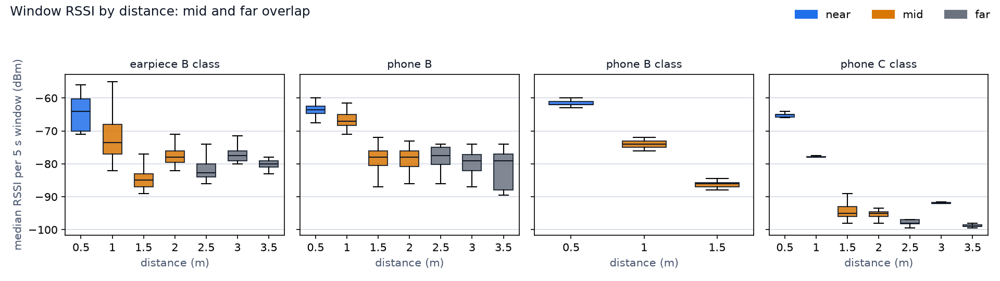

# First model: device type and distance band

Date: 2026-11-22. Data: the 24 labelled calibration sessions from the same day (see [the calibration report](../2026-11-22-calibration/report.md)). Bands as in `docs/data-protocol.md`: near under 1 m, mid 1 to 2 m, far 2 to 3.5 m. Model: the random forest in `ml/train.py`, all 24 features in `ml/features.py`, 5 s windows with a 1 s step.

Files in this folder:

- `make_checks.py`: makes everything below from `data/raw/` (run from the repo root). It also saves both models to `ml/models/`, which is gitignored.
- `train_output.md`: the standard `ml.train` report.
- `confusion_type.csv`, `confusion_band.csv`: the two confusion matrices.
- `checks.txt`: the extra checks quoted below.
- `rssi_by_distance.png`: window RSSI by distance for each device.

## Summary

| | Accuracy on unseen sessions | Target | Result |
| --- | --- | --- | --- |
| Device type (DR2) | 100.0% | 85% | Passes on paper, but proves little: one earpiece, no smartwatch, no `allowed` device |
| Distance band (DR3) | 59.7% | 80% | Fails |

**Mid vs far is not separable with this data.** From the device's own Bluetooth signal, a model that has never seen the session scores 48.9% on mid vs far, which is a coin toss. The model only gets above chance by using the nRF spectrum features, and those follow the room's Wi-Fi traffic over the day, not the distance. Near against the rest works well: 94% of near windows are found when the 1 m edge sessions are left out.

## How it was tested

Whole sessions are held out, never single windows: `ml.train` splits the 24 sessions into 5 groups and tests each group with a model trained on the other four. Every window is predicted by a model that never saw its session. The extra checks in `checks.txt` also use leave one session out (24 folds) and leave one device out (4 folds: test on a device the model never saw).

| Device | Distances | Windows | Type label |
| --- | --- | --- | --- |
| Phone B (fab lab iPhone) | 0.5 to 3.5 m, 7 sessions | 385 | phone |
| Phone B class (iPhone) | 0.5, 1, 1.5 m | 164 | phone |
| Phone C class (Android, nRF Connect) | 0.5 to 3.5 m, 7 sessions | 327 | phone |
| Earpiece B class (Oraimo, case open) | 0.5 to 3.5 m, 7 sessions | 380 | earpiece |

1256 windows in total. Phone C at 3 m has only 7 windows (8 readings in the session).

`0x0942` (Oraimo) was already in `KNOWN_MFR`: it was added with the calibration report (#18), so no code change was needed for it.

## Device type

Accuracy on unseen sessions **100.0%**, on training data 100.0%. Every banned device was flagged as banned.

| true \ predicted | phone | earpiece |
| --- | --- | --- |
| phone | 876 | 0 |
| earpiece | 0 | 380 |

Top features (random forest importance):

| Feature | Importance |
| --- | --- |
| `mfr_oraimo` | 0.273 |
| `n_adv` | 0.195 |
| `adv_interval_ms` | 0.183 |
| `mfr_apple` | 0.076 |
| `mfr_none` | 0.047 |
| `spec_active` | 0.043 |

What the 100% means: the only earpiece is the only Oraimo device, so the model has learned "Oraimo means earpiece". With the manufacturer columns removed it still scores 97.9%, because the earpiece advertises about 1.5 times a second and the phones 2.7 to 6.4 times. Both are facts about these four devices, not about earpieces in general. The model has never been tested on an earpiece it did not train on, and cannot be until a second earpiece is recorded. Smartwatch and `allowed` have no data at all (the Huawei watch was not heard while connected), so the type model is really a two-class phone vs Oraimo model for now. Do not quote 100% as a DR2 result.

## Distance band

Accuracy on unseen sessions **59.7%**, on training data 96.9%. The gap means the model fits each session it trained on but does not carry that over to new ones.

| true \ predicted | near | mid | far |
| --- | --- | --- | --- |
| near | 98 | 121 | 1 |
| mid | 85 | 317 | 196 |
| far | 1 | 102 | 335 |

Top features:

| Feature | Importance |
| --- | --- |
| `rssi_median` | 0.173 |
| `rssi_mean` | 0.162 |
| `rssi_max` | 0.156 |
| `spec_active` | 0.117 |
| `rssi_min` | 0.096 |
| `spec_mean_frac` | 0.077 |
| `spec_adv_frac` | 0.044 |
| `adv_interval_ms` | 0.042 |

RSSI leads, as expected. The two spectrum features in the top six are the problem (next section).

### The spectrum features leak the clock

The nRF24 sees the whole room, and a phone or earpiece advertising at 1.5 m or more is far below the RPD threshold (about -64 dBm). So the spectrum features should say nothing about the test device's distance. They change with the time of day instead:

| Sessions (in recording order) | Minutes after the first | Channels active (median) | Mean hit fraction |
| --- | --- | --- | --- |
| Phone B, all distances | 0 to 13 | 68 to 77 | 0.05 to 0.07 |
| Phone B class and phone C class | 95 to 130 | 31 to 36 | 0.016 to 0.022 |
| Earpiece 0.5 to 2 m | 194 to 199 | 28 to 38 | 0.017 to 0.021 |
| Earpiece 2.5 to 3.5 m | 202 to 204 | 45 to 52 | 0.022 to 0.061 |

The Wi-Fi in the room got busier just as the earpiece moved to the far distances, so "busy spectrum" lines up with "far" for the earpiece by chance. Each device's distances were recorded in order (0.5 m first, 3.5 m last), which makes any drift look like distance. With the spectrum features removed:

| Features | Leave one session out | Leave one device out |
| --- | --- | --- |
| All | 62.9% | 62.6% |
| BLE only | 44.3% | 53.3% |
| Spectrum only | 42.8% | 45.2% |

The honest band number with this data is the BLE-only one, about 44 to 53%.

### Near

Near is the band that works. The low near recall in the matrix above (98 of 220) comes from the 1 m sessions: 1 m is the edge between near and mid, and phone B reads -64 dBm at 0.5 m and -67 dBm at 1 m. Leaving out the sessions that sit exactly on an edge (1 m and 2 m), the BLE-only model finds 208 of 220 near windows (94.5%) and calls only 2 mid or far windows near.

### Mid vs far

| Features | Leave one session out (balanced) | Leave one device out (balanced) |
| --- | --- | --- |
| All | 70.1% | 55.9% |
| BLE only | 48.9% | 53.7% |

Chance is 50%. Without the spectrum leak, mid vs far is at chance, and even one model per device does no better (earpiece 60.0%, phone B 57.6%, phone C 48.7%, each from 6 sessions). With 1 m and 2 m left out, the BLE-only model got 9 of 217 mid windows right (the 1.5 m sessions) and called the rest far.

The graph shows why. Past 1.5 m the window RSSI stops falling: phone B's boxes at 1.5, 2, 2.5, 3 and 3.5 m overlap almost completely around -78 dBm, and the earpiece at 1.5 m (-85 dBm) is weaker than at 3 m (-77 dBm). In a room with a bench, walls and people, reflections decide the RSSI past about 1.5 m, not the distance.

## Plain answer: is mid vs far separable?

No, not with this data. On the device's own Bluetooth signal the model does no better than a coin toss, on every split tried. The 60 to 70% figures above only exist because the room's Wi-Fi got busier while the far sessions were being recorded.

Some of this is the data, not the physics:

- One 60 s session per device per distance, all in one room, one position (desk), on one afternoon.
- Distances recorded in order, so drift in the room lines up with distance.
- Two of the six mid points (1 m and 2 m) sit exactly on a band edge.

What would show whether it can be separated at all:

1. Record mid at 1.5 m and far at 3 m only (the protocol's "record at" points), several sessions each, in shuffled order, at two or three spots in the room.
2. Repeat on another day or in another room, and hold that day out completely.
3. Check RSSI against distance with the unit raised off the bench, since the flat region may come from the bench and nearby walls.

If mid and far still overlap after that, the options are two bands (near, not near) with one unit, or Phase 2 multi-node localization. Both change the AI questions, so they need a decision first.

## Before the next training run

- Remove the spectrum features from the band model, or record so they cannot line up with distance (shuffled order, baselines between sessions). They are meant for spotting audio streaming, and none of these sessions streamed.
- Record a second earpiece, a smartwatch that can be heard, and an `allowed` device, so the type score means something.
- Repeat phone C at 3 m (8 readings) and phone B class past 1.5 m.
